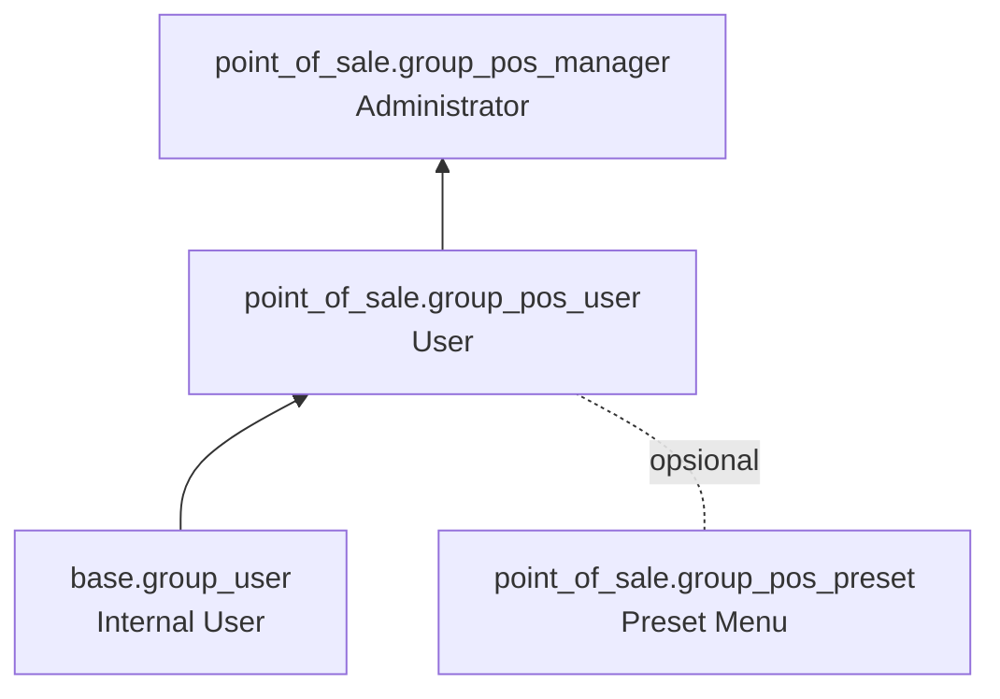

| Grup | Hak |
|---|---|
| User | Membuka sesi, membuat order, pembayaran, cash in/out, melihat order |
| Administrator | Semua hak User + konfigurasi POS, metode pembayaran, kategori, laporan; bisa membatasi perubahan harga (`restrict_price_control`) |

Setiap `pos.config` juga punya `group_pos_user_id` dan `group_pos_manager_id` untuk menentukan grup yang dipakai.

---

_Sumber: dokumentasi_pos_odoo.md §12_
