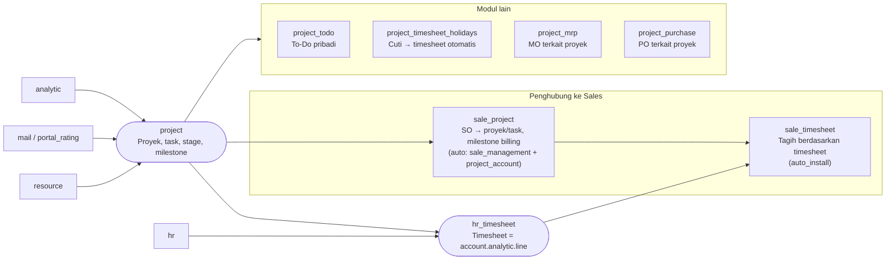

`project` bergantung pada `analytic`, `mail`, `portal_rating`, dan `resource`. Ia **tidak** bergantung pada HR. Pencatatan waktu (timesheet) ditambahkan oleh `hr_timesheet`.

---

_Sumber: dokumentasi_project_odoo.md §1_
