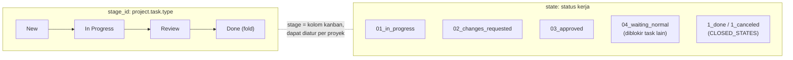

Task punya dua dimensi status yang berbeda:

- **Stage** (`stage_id`) = kolom kanban; bebas didefinisikan dan bisa dipakai bersama oleh beberapa proyek (`project_ids`).
- **State** (`state`) = status kerja task. Saat task pindah stage, state yang belum tertutup kembali ke `01_in_progress`.
- **Personal stage** (`personal_stage_type_id`) = kanban pribadi tiap user (Inbox, Today, …), tidak memengaruhi stage proyek.

---

_Sumber: dokumentasi_project_odoo.md §3_
