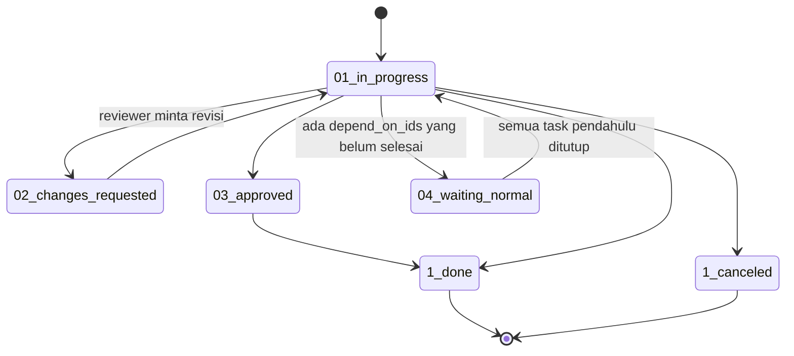

**Rating pelanggan:** jika stage punya `rating_active` dan `auto_validation_state`, balasan rating positif dari pelanggan mengubah state menjadi `03_approved`; rating netral/negatif menjadi `02_changes_requested`.

---

_Sumber: dokumentasi_project_odoo.md §4_
