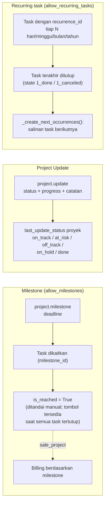

**Template proyek:** proyek dengan `is_template = True` dipakai sebagai cetakan; proyek baru dibuat via `action_create_from_template()` (task dan stage ikut disalin).

---

_Sumber: dokumentasi_project_odoo.md §6_
