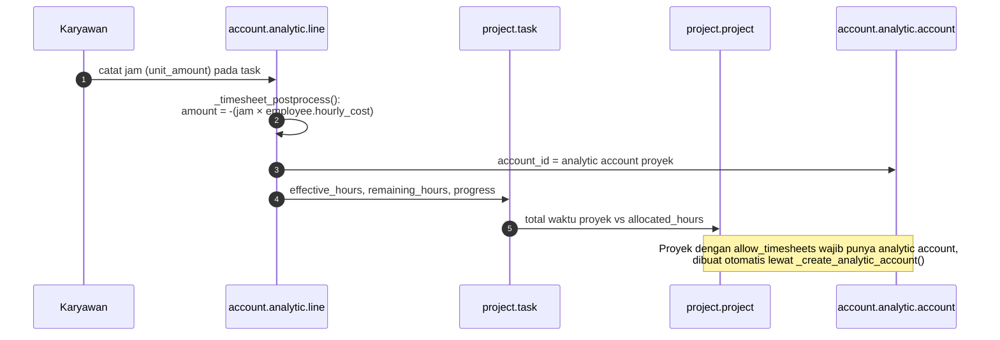
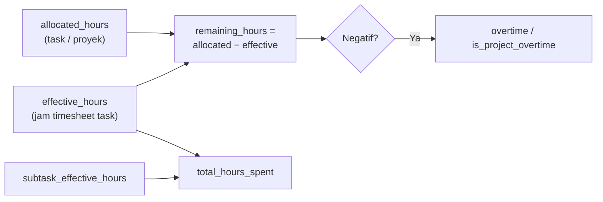

Timesheet adalah `account.analytic.line` yang punya `project_id`. Biayanya dihitung dari tarif karyawan.

- Satuan input: `timesheet_encode_method` = `hours` (jam/menit) atau `days` (hari/setengah hari).
- `internal_project_id` di perusahaan: proyek internal untuk jam non-proyek (cuti, pelatihan, rapat).

---

_Sumber: dokumentasi_project_odoo.md §7_
