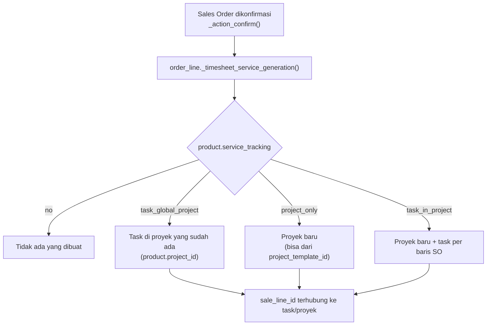

Produk jasa punya `service_tracking` yang menentukan apa yang dibuat saat SO dikonfirmasi.

**Kebijakan penagihan jasa** (`service_policy` di produk):

| Nilai | Arti | invoice_policy |
|---|---|---|
| `ordered_prepaid` | Prepaid / harga tetap | `order` |
| `delivered_milestones` | Berdasarkan milestone (jika fitur milestone aktif) | `delivery` |
| `delivered_timesheet` | Berdasarkan timesheet (`sale_timesheet`) | `delivery` |
| `delivered_manual` | Berdasarkan delivery manual | `delivery` |

---

_Sumber: dokumentasi_project_odoo.md §8_
