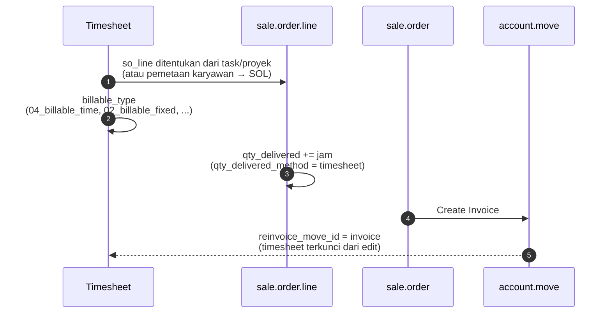

**Pricing proyek** (`pricing_type` di `project.project`):

| Nilai | Arti |
|---|---|
| `task_rate` | Tarif mengikuti SOL di task |
| `fixed_rate` | Satu SOL (tarif) untuk seluruh proyek |
| `employee_rate` | Tarif per karyawan (`project.sale.line.employee.map`) |

---

_Sumber: dokumentasi_project_odoo.md §9_
