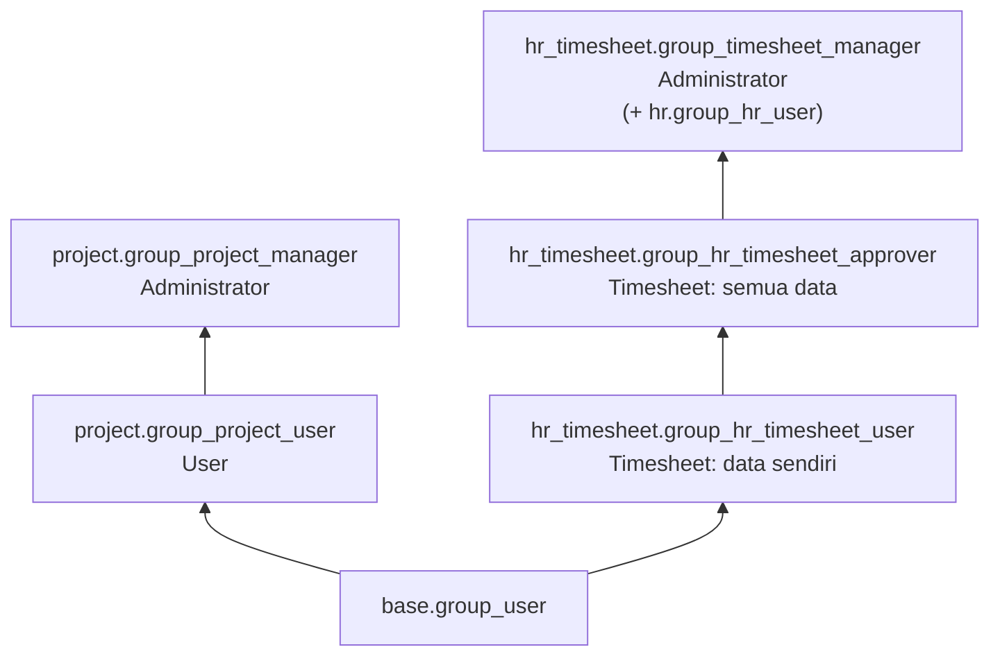

**Fitur proyek** (diaktifkan per proyek, butuh grup):

| Field proyek | Grup |
|---|---|
| `allow_task_dependencies` | `project.group_project_task_dependencies` |
| `allow_milestones` | `project.group_project_milestone` |
| `allow_recurring_tasks` | `project.group_project_recurring_tasks` |
| Stage proyek (`stage_id`) | `project.group_project_stages` |

**Cron:** `Project Stage: Send rating` (`project/data/ir_cron_data.xml`) mengirim permintaan rating untuk task di stage yang `rating_active`. Pengingat timesheet diatur di `hr_timesheet` (`reminder_user_allow`, `reminder_allow`).

---

_Sumber: dokumentasi_project_odoo.md §10_
