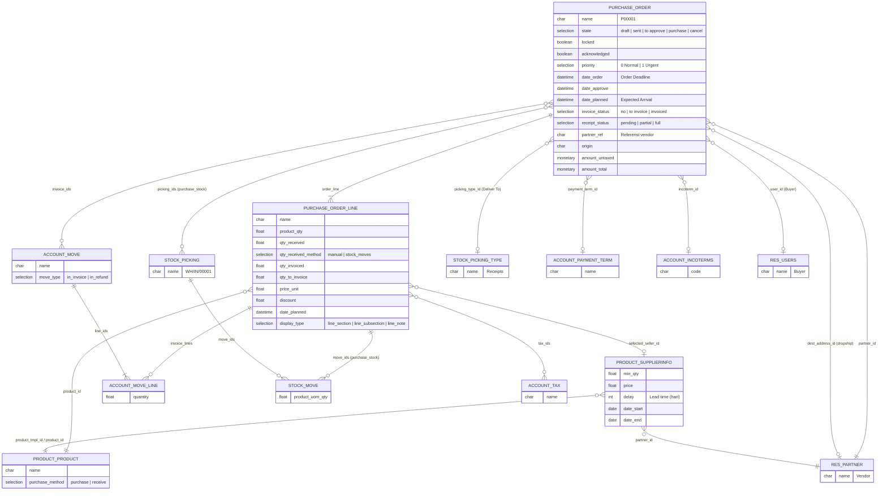

**Model pendukung & wizard:**

| Model | File | Fungsi |
|---|---|---|
| `purchase.bill.line.match` | `purchase/models/purchase_bill_line_match.py` | View pencocokan baris PO ↔ baris vendor bill |
| `bill.to.po.wizard` | `purchase/wizard/bill_to_po_wizard.py` | Buat/tautkan PO dari vendor bill |
| `account.accrued.orders.wizard` | `purchase/wizard/accrued_orders.py` | Jurnal accrual untuk barang diterima tapi belum ditagih |

---

_Sumber: dokumentasi_purchase_odoo.md §2_
