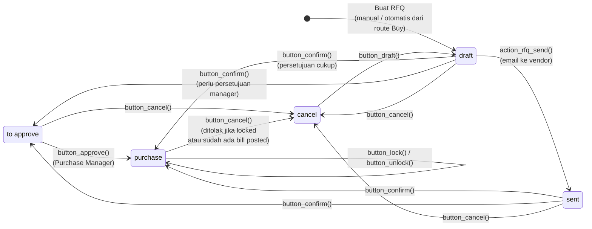

| State | Label | Arti |
|---|---|---|
| `draft` | RFQ | Request for Quotation, bisa diubah |
| `sent` | RFQ Sent | RFQ sudah dikirim ke vendor |
| `to approve` | To Approve | Menunggu persetujuan manager (double validation) |
| `purchase` | Purchase Order | PO dikonfirmasi; receipt dibuat (`purchase_stock`) |
| `cancel` | Cancelled | Dibatalkan |

Seperti Sales, status "Locked/Done" lama diganti field **`locked`**. Jika pengaturan **Lock Confirmed Orders** (`po_lock = lock`) aktif, PO langsung terkunci setelah disetujui. Field `acknowledged` menandai vendor sudah mengonfirmasi PO (`action_acknowledge`).

---

_Sumber: dokumentasi_purchase_odoo.md §3_
