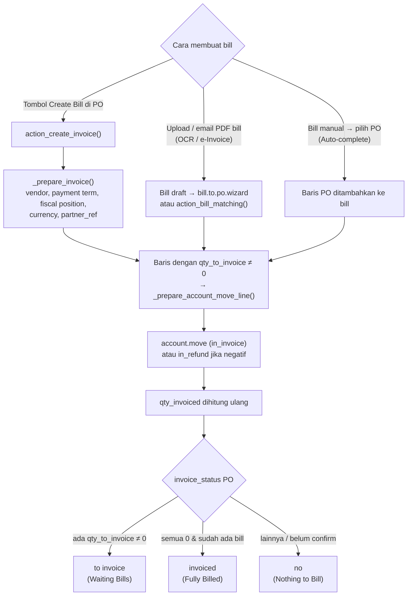

Kebijakan penagihan diatur di produk (`purchase_method`):

- **On ordered quantities (`purchase`)**: bisa ditagih sejak PO dikonfirmasi. `qty_to_invoice = product_qty − qty_invoiced`.
- **On received quantities (`receive`)**: hanya bisa ditagih setelah barang diterima. `qty_to_invoice = qty_received − qty_invoiced`.

**Purchase Matching** (`purchase.bill.line.match`) menampilkan baris PO dan baris bill yang belum cocok per vendor, sehingga bill yang masuk bisa dicocokkan dengan PO yang benar.

---

_Sumber: dokumentasi_purchase_odoo.md §7_
