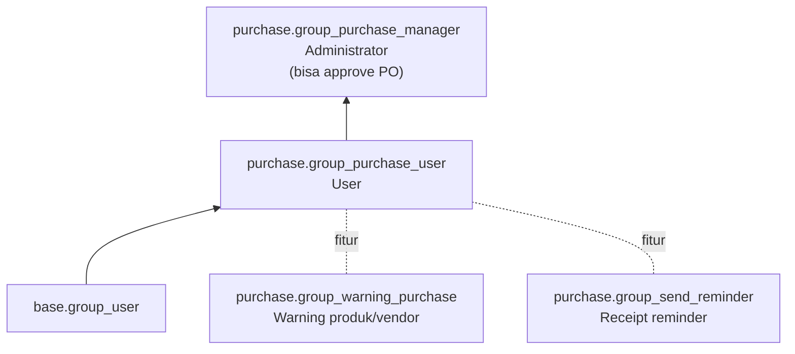

**Cron:** `Purchase reminder` (`purchase/data/ir_cron_data.xml`) mengirim email pengingat ke vendor sebelum tanggal penerimaan, jika `receipt_reminder_email` aktif (grup `purchase.group_send_reminder`).

**Pengaturan perusahaan:**

| Field | Pilihan |
|---|---|
| `po_double_validation` | `one_step` (1 tingkat) / `two_step` (2 tingkat di atas nominal tertentu) |
| `po_double_validation_amount` | Batas nominal yang butuh persetujuan manager |
| `po_lock` | `edit` (PO bisa diubah) / `lock` (PO terkunci setelah konfirmasi) |

**Hak akses:**

---

_Sumber: dokumentasi_purchase_odoo.md §10_
