Di Odoo 20.0, modul `sale` adalah "mesin" penjualan dan **hanya bergantung pada `sales_team`, `account_payment`, dan `utm`**. Fitur seperti template quotation, pengiriman, dan CRM ada di modul terpisah.

```mermaid
flowchart LR
    subgraph DEP["Dependensi (depends)"]
        direction TB
        sales_team
        account_payment["account_payment<br/>(→ account, payment, portal)"]
        utm
    end

    SALE(["sale<br/>Sales internal machinery"])

    subgraph EXT["Modul yang memperluas Sales"]
        direction TB
        sale_management["sale_management<br/>Aplikasi Sales: template quotation,<br/>optional products"]
        sale_crm["sale_crm<br/>Quotation dari opportunity"]
        sale_stock["sale_stock<br/>Delivery order dari SO"]
        sale_project["sale_project / sale_timesheet<br/>Jasa & timesheet"]
        sale_loyalty["sale_loyalty<br/>Promo & kupon"]
        website_sale["website_sale<br/>eCommerce"]
        pos_sale["pos_sale<br/>Ambil SO di POS"]
        sale_purchase["sale_purchase / sale_mrp<br/>Pembelian & produksi dari SO"]
    end

    DEP --> SALE
    SALE --> EXT
```

---

_Sumber: dokumentasi_sales_odoo.md §1_
