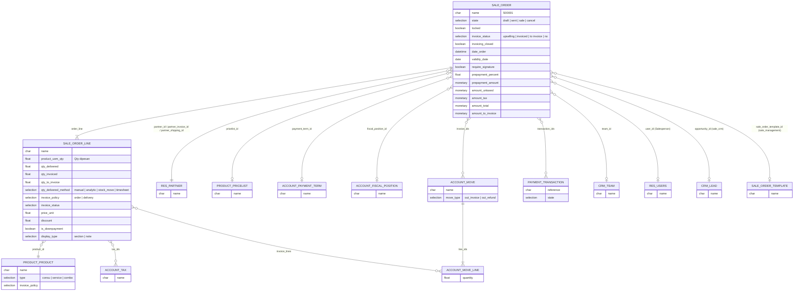

**Model wizard (TransientModel):**

| Model | File | Fungsi |
|---|---|---|
| `sale.advance.payment.inv` | `sale/wizard/sale_make_invoice_advance.py` | Create Invoice: reguler, down payment persentase, atau nominal tetap |
| `sale.order.discount` | `sale/wizard/sale_order_discount.py` | Diskon global / per baris |
| `sale.mass.cancel.orders` | `sale/wizard/mass_cancel_orders.py` | Batalkan banyak order |
| `crm.quotation.partner` | `sale_crm/wizard/crm_opportunity_to_quotation.py` | Pilih/buat customer sebelum quotation dari opportunity |

---

_Sumber: dokumentasi_sales_odoo.md §2_
