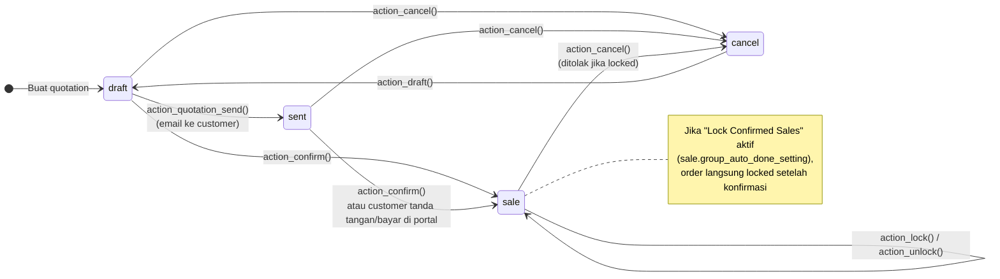

| State | Label | Arti |
|---|---|---|
| `draft` | Quotation | Penawaran, bisa diubah bebas |
| `sent` | Quotation Sent | Penawaran sudah dikirim ke customer |
| `sale` | Sales Order | Sudah dikonfirmasi, memicu pengiriman/invoice |
| `cancel` | Cancelled | Dibatalkan; invoice draft terkait ikut dibatalkan |

Field `locked` menggantikan state "Locked/Done" versi lama. Order yang locked tidak bisa diubah atau dibatalkan sebelum di-unlock.

---

_Sumber: dokumentasi_sales_odoo.md §3_
