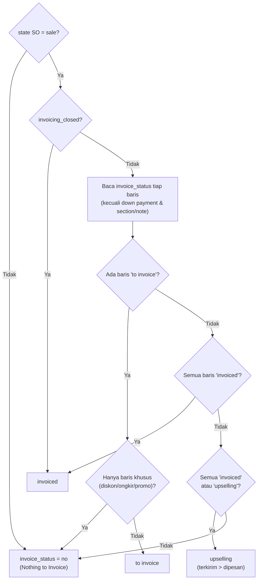

Setiap baris punya `invoice_policy` dari produk:

- **Ordered quantities (`order`)**: yang ditagih = qty dipesan − qty sudah ditagih.
- **Delivered quantities (`delivery`)**: yang ditagih = qty terkirim − qty sudah ditagih.

`qty_delivered` diisi sesuai `qty_delivered_method`: `manual` (diisi tangan), `analytic` (dari expense), ditambah `stock_move` (dari pengiriman, `sale_stock`) dan `timesheet` (`sale_timesheet`).

---

_Sumber: dokumentasi_sales_odoo.md §7_
