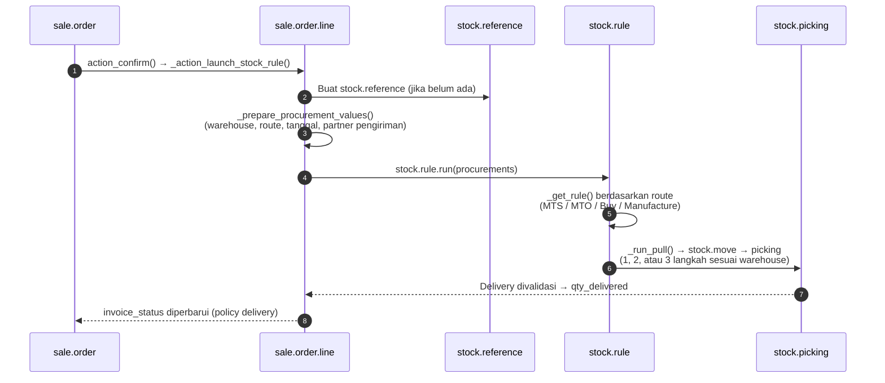

Jika qty di SO yang sudah dikonfirmasi diubah, `_action_launch_stock_rule(previous_product_uom_qty=...)` menjalankan procurement hanya untuk selisihnya.

---

_Sumber: dokumentasi_sales_odoo.md §9_
