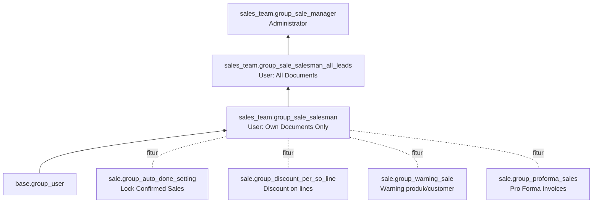

**Cron** (`sale/data/ir_cron.xml`, keduanya **nonaktif** secara default):

| Nama | Method | Fungsi |
|---|---|---|
| automatic invoicing: send ready invoice | `payment.transaction._cron_send_invoice()` | Kirim invoice otomatis setelah pembayaran online |
| Sales: Send pending emails | `sale.order._cron_send_pending_emails()` | Kirim email konfirmasi yang ditunda (`sale.async_emails`) |

**Hak akses** (grup dari `sales_team`):

---

_Sumber: dokumentasi_sales_odoo.md §10_
